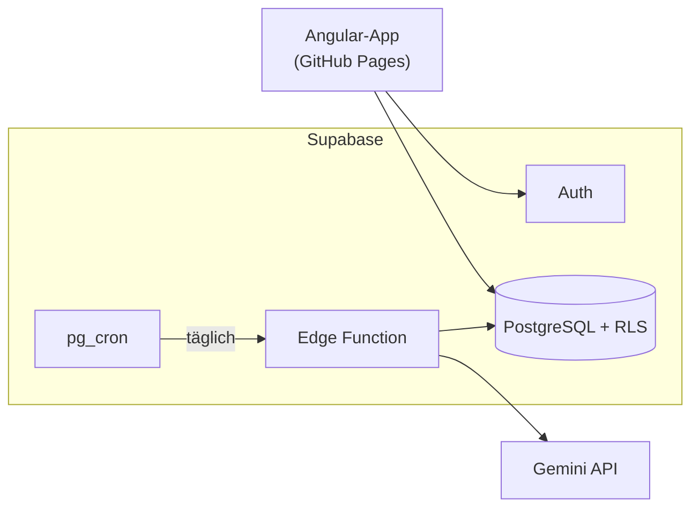

# Architektur

Curio zeigt angemeldeten Nutzern kurze Wissensbeiträge zu Wissenschaft,
Technologie und Psychologie. Jeder Nutzer wählt seine Themen selbst. Neue
Beiträge werden einmal am Tag mit Google Gemini erzeugt.

Die Begründungen für die wichtigsten Entscheidungen stehen in [`adr/`](adr/).

## Überblick



Es gibt keinen eigenen Server. Die Angular-App spricht direkt mit Supabase,
die Zugriffsregeln liegen in der Datenbank.

## Frontend

Der Code ist nach Fachbereichen aufgeteilt und darin nach Schichten:

```text
src/app/
├── core/            Auth, Supabase-Client
└── domains/
    ├── auth/        feature-login
    └── feed/        feature-feed, feature-onboarding, ui, data
```

Eine Feature-Komponente darf `ui`, `data` und `core` benutzen, `ui` nur `data`,
`data` nur `core`. Fachbereiche greifen nicht aufeinander zu. Sheriff prüft das
bei jedem `npm run lint` und in der CI.

Zustand liegt in Signals, Serverdaten kommen über `rxResource`. Beiträge werden
über ein `PostRepository` geladen, damit die Komponenten nicht direkt von
Supabase abhängen. Alle Seiten werden per Lazy Loading geladen.

## Sicherheit

| Tabelle | Lesen | Schreiben |
| --- | --- | --- |
| `posts` | angemeldete Nutzer | nur die Edge Function |
| `user_interests` | eigene Zeilen | eigene Zeilen |

Im Frontend steht nur der Publishable Key. Der Gemini-Schlüssel liegt als
Secret in Supabase.

## Tests und CI

44 Unit-Tests mit Vitest, dazu ESLint und Sheriff. GitHub Actions führt bei
jedem Push Lint, Tests und Build aus und veröffentlicht nur, wenn alles grün
ist.

## Bekannte Grenzen

- KI-Beiträge können inhaltlich falsch sein. Sie sind deshalb gekennzeichnet,
  eine echte Faktenprüfung gibt es noch nicht.
- Likes und Kommentare sind nur Zahlen ohne Funktion.
- RLS-Regeln und der Ablauf gegen eine echte Datenbank sind nicht automatisch
  getestet.

## Entscheidungen

1. [Supabase statt eigenem Backend](adr/0001-supabase-als-backend.md)
2. [Fachbereiche und Schichten mit Sheriff](adr/0002-domaenen-und-schichten-mit-sheriff.md)
3. [Signals statt NgRx](adr/0003-signals-statt-ngrx.md)
4. [Repository für den Datenzugriff](adr/0004-repository-fuer-datenzugriff.md)
5. [KI-Beiträge serverseitig und pro Kategorie](adr/0005-ki-beitraege-serverseitig-pro-kategorie.md)
6. [Zugriffsschutz über RLS](adr/0006-sicherheit-ueber-rls.md)
