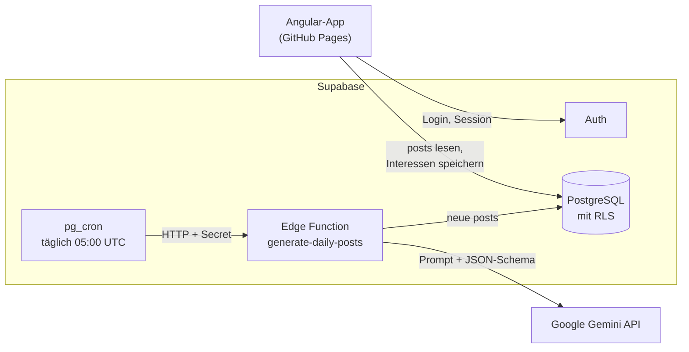
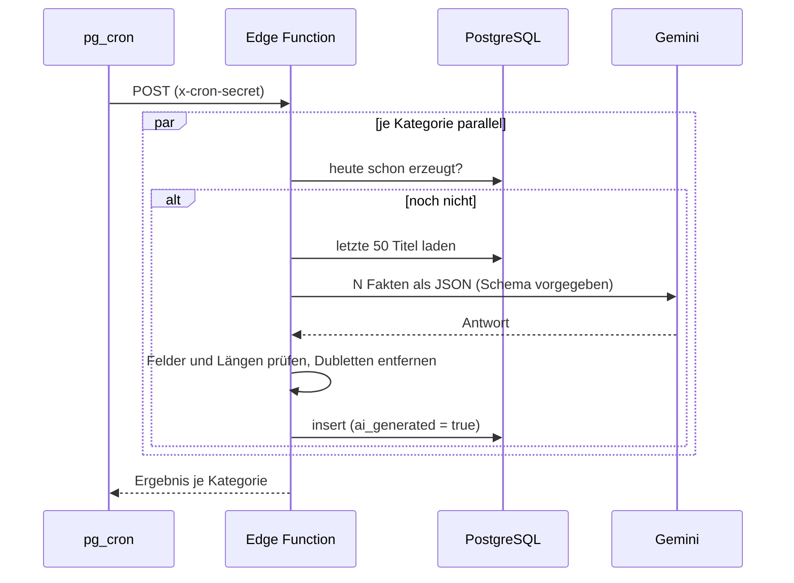

# Architektur von Curio

Stand: November 2026

Dieses Dokument beschreibt, wie Curio aufgebaut ist und warum. Die einzelnen
Entscheidungen mit Begründung und Alternativen stehen als Architecture Decision
Records (ADRs) in [`docs/adr/`](adr/).

## 1. Worum es geht

Curio zeigt angemeldeten Nutzern kurze Wissensbeiträge aus den Bereichen
Wissenschaft, Technologie und Psychologie. Jeder Nutzer wählt, welche Bereiche
er sehen will. Neue Beiträge entstehen einmal am Tag automatisch über die
Gemini-API von Google.

Das Projekt ist bewusst klein gehalten: ein Entwickler, keine eigene
Server-Anwendung, drei Seiten im Frontend. Die Architektur soll trotzdem so
angelegt sein, dass sie mit mehr Funktionen und mehr Leuten im Team nicht
auseinanderfällt.

## 2. Systemüberblick



| Baustein | Aufgabe | Wo es läuft |
| --- | --- | --- |
| Angular-App | Oberfläche, Routing, Formulare, Anzeige | statisch auf GitHub Pages |
| Supabase Auth | Registrierung, Login, Session-Tokens | Supabase |
| PostgreSQL | Tabellen `posts` und `user_interests`, Zugriffsregeln (RLS) | Supabase |
| Edge Function | ruft Gemini auf, prüft die Antwort, schreibt neue Beiträge | Supabase (Deno) |
| pg_cron + pg_net | startet die Edge Function einmal täglich | in der Datenbank |
| Gemini API | erzeugt die Beitragstexte | Google |

Es gibt keinen eigenen Applikationsserver. Die Gründe stehen in
[ADR 0001](adr/0001-supabase-als-backend.md).

## 3. Wichtige Abläufe

### Login und erster Besuch

1. Die Login-Seite schickt E-Mail und Passwort an Supabase Auth.
2. Danach navigiert sie immer zu `/home`.
3. Auf `/home` liegen zwei Guards: `authGuard` prüft die Session,
   `onboardingCompleteGuard` prüft, ob der Nutzer schon Interessen gespeichert
   hat. Wenn nicht, geht es zu `/interest-setup`.

Die Entscheidung "Onboarding nötig?" liegt damit im Feed-Bereich und nicht im
Login. Der Login muss nichts über Interessen wissen (siehe Abschnitt 4).

### Feed laden

Die Feed-Seite lädt Beiträge über eine Angular-Resource (`rxResource`). Die
Resource hängt nur von der gewählten Kategorie ab. Ändert sich die Kategorie,
lädt Angular neu; Ladezustand und Fehler stehen als Signals bereit. Die Filterung
nach den eigenen Interessen passiert danach lokal in einem `computed()`, ohne
neue Anfrage.

### Tägliche Beiträge



Details und Begründung: [ADR 0005](adr/0005-ki-beitraege-serverseitig-pro-kategorie.md).

## 4. Aufbau des Frontends

Der Code ist nach Fachbereich (Domain) gegliedert und innerhalb jedes Bereichs
nach Schicht. Das folgt der Empfehlung des Angular Style Guide, nach Features
statt nach Dateityp zu ordnen, und dem Schichtenmodell aus Manfred Steyers
"Enterprise Angular".

```text
src/app/
├── core/                 # einmal pro App: Auth, Supabase-Client
└── domains/
    ├── auth/
    │   └── feature-login/
    └── feed/
        ├── feature-feed/
        ├── feature-onboarding/
        ├── ui/           # PostCard, CategoryFilter, InterestPicker
        └── data/         # Modelle, Repositories, Services, Kategorien
```

Erlaubte Abhängigkeiten:

| Von | Darf zugreifen auf |
| --- | --- |
| `feature` | `ui`, `data`, `util`, `core` |
| `ui` | `data`, `util` |
| `data` | `util`, `core` |
| `core` | `core`, Konfiguration |
| Domain A | nur Domain A und `core` |

Diese Regeln stehen in `sheriff.config.ts` und werden bei `npm run lint` und in
der CI geprüft. Ein Import in die falsche Richtung bricht den Build ab.
Begründung: [ADR 0002](adr/0002-domaenen-und-schichten-mit-sheriff.md).

Alle drei Seiten werden per Lazy Loading geladen. Beim letzten Build lag der
initiale Download bei rund 115 kB (komprimiert); Login, Feed und Onboarding
kommen als eigene Chunks mit 9,6 kB, 4,0 kB und 1,3 kB nach.

## 5. Zustand und Datenzugriff

- Zustand liegt in Signals. Die App läuft ohne zone.js (Standard seit
  Angular 21). Alle Komponenten nutzen `ChangeDetectionStrategy.OnPush`.
- Serverdaten kommen über `rxResource`, abgeleitete Werte über `computed()`.
- Komponenten greifen nicht direkt auf Supabase zu. Beiträge laufen über die
  abstrakte Klasse `PostRepository`; die Supabase-Implementierung ist in
  `app.config.ts` registriert und für Tests austauschbar.
- Der Supabase-Client wird per `InjectionToken` bereitgestellt, nicht als
  globale Variable.

Warum kein NgRx: [ADR 0003](adr/0003-signals-statt-ngrx.md).
Warum Repository: [ADR 0004](adr/0004-repository-fuer-datenzugriff.md).

## 6. Sicherheit

Das Frontend ist öffentlich, also auch alles, was im Bundle steht. Deshalb gilt:
Keine Regel, die Daten schützt, darf nur im Frontend stehen.

| Tabelle | Lesen | Schreiben |
| --- | --- | --- |
| `posts` | angemeldete Nutzer | nur serverseitig (Edge Function) |
| `user_interests` | nur eigene Zeilen | nur eigene Zeilen, über `save_user_interests()` |

- Im Frontend steht nur der Publishable Key. Er ist laut Supabase für den
  Browser gedacht, sofern RLS aktiv ist.
- Der Gemini-Schlüssel und der Server-Schlüssel liegen ausschließlich als
  Secrets in Supabase.
- Die Edge Function prüft einen eigenen Header (`x-cron-secret`), damit nicht
  jeder auf Kosten des Projekts Beiträge erzeugen kann.

Begründung: [ADR 0006](adr/0006-sicherheit-ueber-rls.md).

## 7. Qualitätssicherung

| Was | Werkzeug | Umfang |
| --- | --- | --- |
| Unit- und Komponententests | Vitest + Angular TestBed | 44 Tests in 11 Dateien |
| Code-Stil, Angular-Regeln, Barrierefreiheit in Templates | angular-eslint | gesamter `src/` |
| Architekturregeln | Sheriff | gesamter `src/` |
| Pipeline | GitHub Actions | Lint, Tests, Build bei jedem Push; Deployment nur wenn alles grün ist |

Verteilung der Tests:

| Bereich | Tests |
| --- | --- |
| Routing und App | 6 |
| Guards | 6 |
| Feature-Komponenten (Login, Feed) | 11 |
| UI-Komponenten | 9 |
| Services und Repository | 12 |

Die Tests konzentrieren sich auf Logik, die tatsächlich schiefgehen kann:
Weiterleitungen der Guards, Validierung im Login, Filterung im Feed,
Fehlerzustände. End-to-End-Tests gegen eine echte Supabase-Instanz gibt es noch
nicht.

## 8. Bekannte Grenzen

Ehrlich festgehalten, damit niemand sie für Absicht hält:

- **KI-Inhalte können falsch sein.** Sprachmodelle erzeugen nachweislich
  plausible, aber falsche Aussagen (Ji et al., 2023). Der Prompt verlangt
  belegte Fakten und eine Quelle, eine echte Faktenprüfung findet aber nicht
  statt. Beiträge sind deshalb im Feed als "KI-generiert" gekennzeichnet.
- **Kein Jitter beim Retry.** Die Edge Function wiederholt fehlgeschlagene
  Gemini-Anfragen mit wachsender Wartezeit, aber ohne Zufallsanteil. Bei einem
  einzigen täglichen Aufruf ist das unkritisch; bei vielen parallelen Aufrufern
  würde man Jitter ergänzen.
- **Modell nicht festgepinnt.** Standard ist der Alias `gemini-flash-latest`.
  Google empfiehlt für Produktion eine feste Version. Über das Secret
  `GEMINI_MODEL` lässt sich das ohne Code-Änderung umstellen.
- **Likes und Kommentare sind nur Zahlen.** Es gibt noch keine Interaktion.
- **Deep Links auf GitHub Pages** liefern HTTP-Status 404 mit der App als
  Inhalt. Für Nutzer funktioniert das, für Suchmaschinen ist es nicht ideal.
- **Session-Prüfung im Guard** liest die lokal gespeicherte Session
  (`getSession()`) statt bei jedem Seitenwechsel den Server zu fragen. Das ist
  schneller; ein Nutzer, der serverseitig gesperrt wurde, sieht die geschützten
  Seiten bis zum Ablauf des Tokens. Seine Daten schützt trotzdem RLS.

## 9. Entscheidungen

| Nr. | Titel |
| --- | --- |
| [0001](adr/0001-supabase-als-backend.md) | Supabase statt eigenem Backend |
| [0002](adr/0002-domaenen-und-schichten-mit-sheriff.md) | Domänen und Schichten, geprüft mit Sheriff |
| [0003](adr/0003-signals-statt-ngrx.md) | Signals und Resource-API statt NgRx |
| [0004](adr/0004-repository-fuer-datenzugriff.md) | Repository als Grenze zum Datenzugriff |
| [0005](adr/0005-ki-beitraege-serverseitig-pro-kategorie.md) | KI-Beiträge serverseitig und pro Kategorie |
| [0006](adr/0006-sicherheit-ueber-rls.md) | Zugriffsschutz in der Datenbank (RLS) |

## Quellen

- Angular: Style Guide, <https://angular.dev/style-guide>
- Angular: Signals, <https://angular.dev/guide/signals>
- Angular: Zoneless, <https://angular.dev/guide/zoneless>
- Supabase: Row Level Security, <https://supabase.com/docs/guides/database/postgres/row-level-security>
- Supabase: API Keys, <https://supabase.com/docs/guides/api/api-keys>
- Supabase: Scheduling Edge Functions, <https://supabase.com/docs/guides/functions/schedule-functions>
- Gemini API: Modelle, <https://ai.google.dev/gemini-api/docs/models>
- M. Steyer: Enterprise Angular (Leanpub), <https://leanpub.com/enterprise-angular>
- Sheriff, <https://github.com/softarc-consulting/sheriff>
- Z. Ji et al. (2023): Survey of Hallucination in Natural Language Generation.
  ACM Computing Surveys 55(12). <https://doi.org/10.1145/3571730>
- M. Nygard (2011): Documenting Architecture Decisions,
  <https://cognitect.com/blog/2011/11/15/documenting-architecture-decisions>
